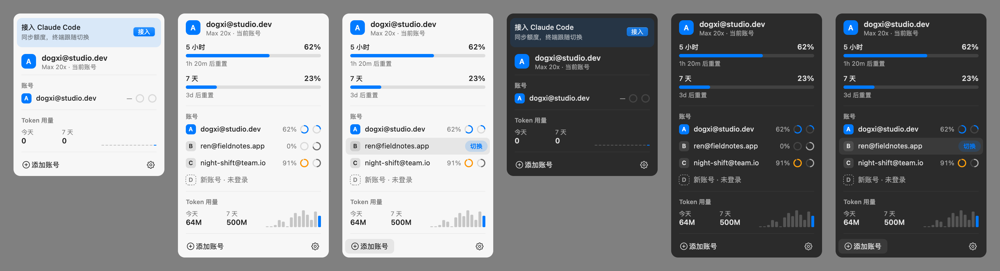

<div align="center">


# kawari

**替わり** — 菜单栏里的 Claude Code 账号切换器

一眼看完账号剩余额度，点一下换过去。

轻量，开源，用起来不烧心。

macOS 14+　·　不到 1 MB　·　原生 AppKit　·　不联网

[English](README.en.md)



</div>

## 安装

从 [Releases](https://github.com/dogxii/kawari/releases) 下载，拖进「应用程序」。尚未公证：首次打开请在访达中右键 → 打开。

第一次打开后点面板顶部的「接入」，额度就会开始同步。

## 它是怎么做的

只用 Claude Code 官方提供的机制，不调用任何非公开接口。

- **多账号**：主账号是 `~/.claude`，其余账号各占 `~/.claude-accounts/<n>`，靠官方的 `CLAUDE_CONFIG_DIR` 隔离登录，钥匙串条目也按目录区分。登录走 `claude auth login`。
- **共用数据**：副账号目录里除了 `.claude.json` 与凭证，其余全部软链接到 `~/.claude`。会话记录、`--resume`、设置、skills、插件都是同一份；MCP 服务器以主账号为准同步过去。
- **切换**：把选中的目录写进 `~/.config/kawari/current`。`~/.zshrc` 里的一小段在每条命令前读取它，已打开的终端也会跟着换；同时 `launchctl setenv`，之后打开的 App（如 VS Code）也会使用它。正在运行的会话不受影响。
- **额度**：Claude Code 会把官方的 `rate_limits` 交给 status line。kawari 在这里记下一份到 `~/.config/kawari/usage/`，再原样转给你原来的 status line。闲置的账号过了重置时间就按已清零显示。
- **用量**：增量读取 `~/.claude/projects` 下最近 14 天的会话记录，统计 token（含缓存读写，口径与 ccusage 一致）。

「接入 Claude Code」只改动 `~/.claude/settings.json` 的 `statusLine` 和 `~/.zshrc` 里带标记的一段；在菜单里关掉即完整还原。

## 构建

```sh
./scripts/build.sh              # build/kawari.app（Apple Silicon）
./scripts/build.sh --universal  # 同时支持 Intel
./scripts/build.sh --dmg        # 额外生成 DMG
swift test                      # 账号、接入、钩子脚本、用量统计
./scripts/snapshot.sh           # 渲染面板对照图到 build/snapshots/
./scripts/icon.sh               # 重新生成 App 图标
```
